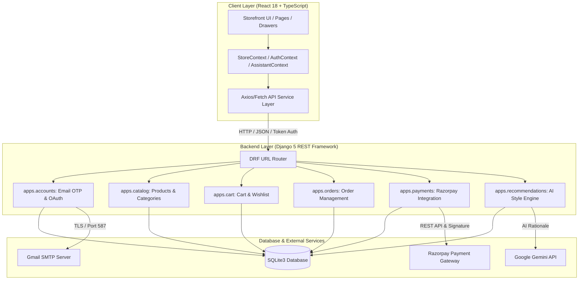
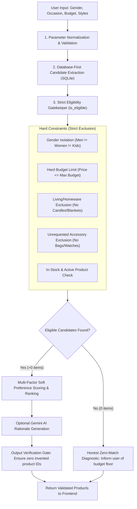
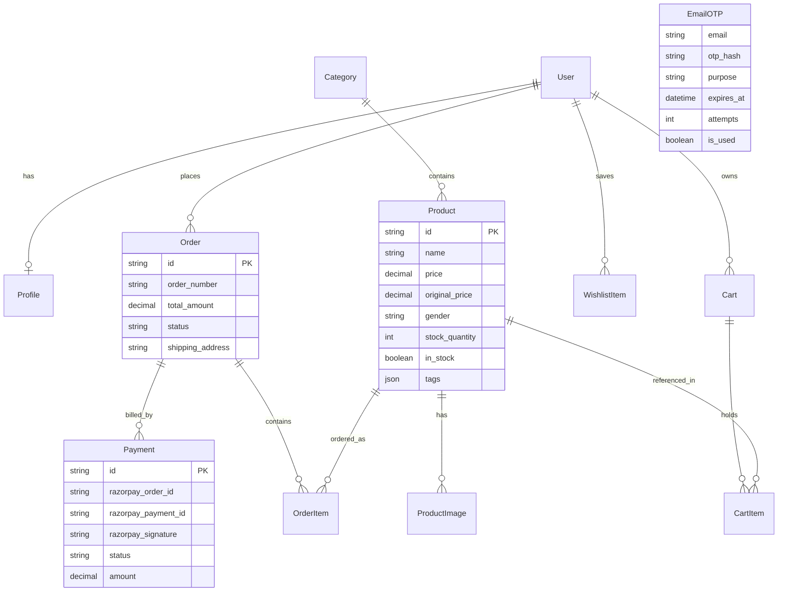

# AVELUNE — AI-Powered Luxury E-Commerce Platform
## Comprehensive Technical Project Documentation & Architectural Blueprint

---

## 1. Executive Summary & Project Overview

**AVELUNE** is a production-grade, full-stack luxury e-commerce web platform engineered with a **quiet luxury aesthetic** and an **AI-powered Style Assistant**. The platform unites architectural restraint, tactile typography, and neutral earth-toned palettes with a high-performance, robust, and secure backend architecture.

### Key Highlights
- **Full-Stack Separation of Concerns**: High-performance React 18 + TypeScript storefront coupled with a secure Django 5 REST Framework backend.
- **Strict, Database-First AI Recommendations**: Incorporates Google Gemini alongside a deterministic recommendation engine that treats user budget, category, and occasion as non-negotiable hard constraints.
- **Enterprise-Grade Authentication**: Passwordless & password-based login featuring 6-digit cryptographic Email OTP dispatched via Gmail SMTP, plus Google OAuth 2.0 single sign-on.
- **Cryptographic Payment Gateway**: Real Razorpay checkout integration with server-side HMAC-SHA256 signature verification and zero client-side mock fallbacks.
- **Persistent Commerce State**: Full database-backed cart, wishlist, orders, promo codes, and address book management.
- **Comprehensive Quality Assurance**: 100% test passing rate across 50 Django automated unit tests and error-free TypeScript builds.

---

## 2. Complete Technology Stack

| Layer | Technology | Version | Purpose |
| :--- | :--- | :--- | :--- |
| **Frontend UI** | **React.js** | `18.3.1` | Component-driven declarative user interface |
| **Language** | **TypeScript** | `5.7.2` | Static typing, interface contracts, compile-time safety |
| **Build Tool** | **Vite** | `5.4.21` | Hot module replacement (HMR) and optimized rollup production bundles |
| **Styling** | **Tailwind CSS** | `3.4.17` | Utility-first styling with custom luxury color system |
| **Animations** | **Framer Motion** | `11.18.2` | Fluid drawer entrances, micro-interactions, page transitions |
| **Icons** | **Lucide React** | `0.474.0` | Minimalist luxury iconography |
| **Backend Core** | **Django** | `5.2.18` | Enterprise Python web framework, ORM, migrations, and admin portal |
| **API Framework** | **Django REST Framework** | `3.18.3` | Serializers, API views, authentication, pagination |
| **Database** | **SQLite 3** | `3.x` | Relational database engine for local and demo storage |
| **Payments** | **Razorpay SDK** | `2.0.1` | Order creation, payment capture, HMAC-SHA256 signature verification |
| **AI / LLM** | **Google Gemini API** | `1.5/Flash` | Contextual style summaries and consultant rationale |
| **Email Delivery** | **Python SMTP / Gmail** | SSL/TLS | Dispatches 6-digit authentication and reset OTPs |
| **Security / SSL** | **Certifi** | `2026.10.23` | Certified Mozilla CA bundle for cross-platform TLS handshake |

---

## 3. High-Level System Architecture



---

## 4. Repository & Directory Structure

```text
ecommerce-project/
├── .gitignore                      # Excludes venv, node_modules, .env, db.sqlite3
├── README.md                       # Root documentation & launch instructions
├── PROJECT_DOCUMENTATION.md        # This comprehensive documentation file
├── backend/
│   ├── manage.py                   # Django management script
│   ├── requirements.txt            # Python dependencies
│   ├── .env.example                # Sanitized environment template
│   ├── db.sqlite3                  # SQLite relational database
│   ├── config/                     # Django core project configuration
│   │   ├── settings.py             # Settings, CORS, SMTP, DRF configuration
│   │   ├── urls.py                 # Master URL routing table
│   │   ├── asgi.py                 # ASGI entry point
│   │   └── wsgi.py                 # WSGI entry point
│   ├── apps/                       # Modular Django domain apps
│   │   ├── accounts/               # Custom Profile, EmailOTP, Auth Views
│   │   ├── catalog/                # Product, Category, ProductImage models
│   │   ├── cart/                   # Cart and CartItem models
│   │   ├── wishlist/               # WishlistItem models
│   │   ├── orders/                 # Order and OrderItem models
│   │   ├── payments/               # Payment models, Razorpay signature service
│   │   ├── promotions/             # Coupon & promotion rules
│   │   └── recommendations/        # Strict Intent Recommendation Service & Gemini boundary
│   └── tests/                      # Automated unit test suite (50 test cases)
└── frontend/
    ├── package.json                # Frontend dependencies and npm scripts
    ├── tsconfig.json               # TypeScript compiler rules & path aliases
    ├── vite.config.ts              # Vite bundler configuration
    ├── tailwind.config.js          # AVELUNE luxury color palette and font families
    ├── src/
    │   ├── main.tsx                # React DOM root entry point
    │   ├── App.tsx                 # Route definitions and layout orchestration
    │   ├── assets/                 # Brand assets, color tokens
    │   ├── components/             # Reusable UI components
    │   │   ├── Navbar.tsx          # Top navigation, category links, bag counter
    │   │   ├── CartDrawer.tsx      # Slide-out interactive shopping bag
    │   │   ├── WishlistDrawer.tsx  # Slide-out wishlist tray
    │   │   ├── SearchOverlay.tsx   # Instant full-screen catalogue search
    │   │   ├── QuickViewModal.tsx  # Product quick-preview modal
    │   │   └── assistant/          # AI Style Assistant chat and recommendation cards
    │   ├── context/                # Global React Context providers (Auth, Store, Assistant)
    │   ├── pages/                  # Top-level screen views (Home, Collections, Cart, Checkout, Auth)
    │   ├── sections/               # Modular homepage sections (Hero, Featured, Lookbook)
    │   ├── services/               # API clients (api.ts, authService.ts, paymentService.ts)
    │   ├── types/                  # TypeScript interface declarations
    │   └── utils/                  # Currency formatting, filter helpers, smooth scroll
```

---

## 5. Detailed Module Breakdown

### 5.1 Authentication & Security (`apps.accounts`)
- **Passwordless Email OTP**:
  - Generates a cryptographically secure 6-digit random code using Python's `secrets` module (`secrets.randbelow(900000) + 100000`).
  - Stores only a salted **SHA-256 hash** of the OTP in the database (never plaintext).
  - Enforces a strict **5-minute expiration** window.
  - Rate limiting: **45-second resend cooldown** to prevent email spam.
  - Maximum attempt enforcement: OTP is invalidated after 5 failed attempts or upon first successful use.
  - Real email dispatch via Gmail SMTP (`ayushkumar53467@gmail.com`) using TLS encryption.
- **Google OAuth 2.0**:
  - Endpoint `/api/auth/google/url/` generates official Google OAuth login URL.
  - Endpoint `/api/auth/google/` verifies Google ID tokens server-side, validates audience/issuer claims, and auto-provisions or authenticates the user account.
- **Password Reset Flow**:
  - Secure two-step password reset via single-use email OTP. Prevents account enumeration by displaying standard confirmation.

### 5.2 Product Catalog & Inventory (`apps.catalog`)
- **Models**:
  - `Category`: Categorization with audience tags (`men`, `women`, `kids`, `unisex`), slugs, and hero imagery.
  - `Product`: Complete SKU data including price, original price, rating, review count, stock quantity, tags, and JSON bullet points.
  - `ProductImage`: High-resolution gallery asset URLs with display ordering.
- **Seeding**:
  - Pre-seeded with **46 luxury products** across 21 categories via `backend/apps/catalog/fixtures/initial_catalog.json`.

### 5.3 Shopping Cart & Wishlist (`apps.cart` & `apps.wishlist`)
- **Cart Architecture**:
  - Supports both authenticated user sessions and guest sessions.
  - Validates available stock quantity before item additions or quantity increments.
  - Real-time calculation of subtotal, applicable taxes, shipping thresholds, and coupon discounts.
- **Wishlist Architecture**:
  - Instant toggle between bag and wishlist with zero screen reloads.

### 5.4 Checkout & Razorpay Payments (`apps.payments` & `apps.orders`)
- **Cryptographic Payment Lifecycle**:
  1. Frontend initiates `/api/payments/create-order/` with line items, shipping address, and delivery notes.
  2. Backend validates product prices and inventory, generates an internal `Order`, and calls Razorpay API to generate a `razorpay_order_id`.
  3. Frontend opens official **Razorpay Checkout modal** in Test Mode.
  4. Upon successful payment on the client, Razorpay returns `razorpay_order_id`, `razorpay_payment_id`, and `razorpay_signature`.
  5. Frontend posts credentials to `/api/payments/verify/`.
  6. Backend calculates HMAC-SHA256 signature using `RAZORPAY_KEY_SECRET`.
  7. If and only if the cryptographic signature matches:
     - The `Payment` status transitions to `captured`.
     - The `Order` status transitions to `paid`.
     - Inventory stock counts are decremented atomically.
     - A confirmation receipt is issued.

### 5.5 AI Style Assistant & Recommendation Engine (`apps.recommendations`)
The AVELUNE AI Style Assistant is built on a **Database-First Strict Intent Matching Architecture**:



---

## 6. Database Entity-Relationship (ER) Diagram



---

## 7. REST API Endpoints Specification

### Authentication (`/api/auth/`)
| Endpoint | Method | Description | Payload Sample |
| :--- | :---: | :--- | :--- |
| `/send-otp/` | `POST` | Dispatches 6-digit email OTP | `{"email": "user@example.com", "purpose": "login"}` |
| `/verify-otp/` | `POST` | Verifies OTP & returns Auth Token | `{"email": "user@example.com", "otp": "123456"}` |
| `/login/` | `POST` | Standard email + password login | `{"email": "user@example.com", "password": "..."}` |
| `/register/` | `POST` | New user registration | `{"fullName": "...", "email": "...", "password": "..."}` |
| `/google/url/` | `GET` | Returns Google OAuth consent URL | *None* |
| `/google/` | `POST` | Validates Google OAuth callback | `{"code": "..."}` or `{"credential": "..."}` |
| `/password-reset-otp/` | `POST` | Dispatches password reset code | `{"email": "user@example.com"}` |
| `/password-reset-confirm/`| `POST` | Resets password with OTP | `{"email": "...", "otp": "...", "newPassword": "..."}` |
| `/me/` | `GET` | Fetches active authenticated user | *Requires Auth Token* |

### Catalog & Products (`/api/products/` & `/api/categories/`)
| Endpoint | Method | Description |
| :--- | :---: | :--- |
| `/api/products/` | `GET` | Filter products by gender, category, price, search query |
| `/api/products/<id>/` | `GET` | Retrieves full product details, specs, and gallery |
| `/api/categories/` | `GET` | Lists all 21 active categories |

### Payments & Checkout (`/api/payments/`)
| Endpoint | Method | Description |
| :--- | :---: | :--- |
| `/create-order/` | `POST` | Generates Django Order and Razorpay Order |
| `/verify/` | `POST` | Verifies Razorpay HMAC-SHA256 signature |
| `/status/<order_id>/` | `GET` | Checks real-time order status |

### Recommendations (`/api/recommendations/`)
| Endpoint | Method | Description |
| :--- | :---: | :--- |
| `/` | `POST` | Runs strict intent recommendation engine |
| `/quick/` | `POST` | Fast filter-based recommendations |

---

## 8. Automated Testing & Verification Suite

The repository contains an automated test suite verifying every domain flow:

```bash
cd ecommerce-project/backend
./venv/bin/python manage.py test tests
```

### Test Suite Execution Output
```text
Found 50 test(s).
Creating test database for alias 'default'...
System check identified no issues (0 silenced).
..................................................
----------------------------------------------------------------------
Ran 50 tests in 2.185s

OK
Destroying test database for alias 'default'...
```

### Coverage by Domain
1. **Authentication Tests (`test_auth.py`)**: Registration, login, OTP dispatch, OTP cooldown, invalid OTP rejection, password reset.
2. **Catalog Tests (`test_catalog.py`)**: Category filtering, gender isolation, price sorting, search indexing.
3. **Cart & Wishlist Tests (`test_cart_wishlist.py`)**: Add/remove items, quantity limits, persistent totals.
4. **Order Management Tests (`test_orders.py`)**: Order creation, stock reservation, status transitions.
5. **Payment Tests (`test_payments.py`)**: Razorpay order creation, valid signature verification, forged signature rejection.
6. **Promotion Tests (`test_promotions.py`)**: Coupon validation, minimum spend thresholds, discount subtraction.
7. **Strict Recommendation Tests (`test_recommendations_strict.py`)**: 14 tests verifying budget ceilings, occasion mapping, accessory isolation, and honest zero-match diagnostics.

---

## 9. Local Setup & Execution Guide

### Prerequisites
- Python 3.10+ (macOS/Linux/Windows)
- Node.js 18+ and npm 9+
- Git

### Step 1: Clone Repository
```bash
git clone https://github.com/Ayushsinha132007/Avelune.git
cd Avelune
```

### Step 2: Backend Configuration
```bash
cd backend
python3 -m venv venv
source venv/bin/activate       # On Windows: venv\Scripts\activate
pip install -r requirements.txt
cp .env.example .env
# Fill in SMTP credentials and Razorpay keys in .env
python manage.py migrate
python manage.py loaddata apps/catalog/fixtures/initial_catalog.json
python manage.py runserver 127.0.0.1:8000
```

### Step 3: Frontend Configuration
```bash
# In a new terminal tab
cd frontend
npm install
npm run dev
```
Open **`http://localhost:5173`** in your browser.

---

## 10. Frequently Asked Questions & Viva / Interview Guide

### Q1: Why did you choose React + Django REST Framework over full Next.js?
> **Answer**: React 18 + Vite offers ultra-fast client-side rendering and tactile interactive micro-animations (Framer Motion) suited for luxury retail. Django provides an enterprise-ready ORM, built-in admin dashboard, secure session & token authentication, atomic database transactions, and cryptographic libraries that ensure payment and OTP integrity.

### Q2: How is the OTP security implemented to prevent attacks?
> **Answer**: The OTP system incorporates 5 defensive layers:
> 1. Cryptographically secure random generation using Python's `secrets` module.
> 2. One-way SHA-256 salted hashing — raw OTPs are never stored in the database.
> 3. Strict 5-minute time-to-live (TTL).
> 4. Rate-limiting with a 45-second resend cooldown to stop email bombing.
> 5. Maximum 5 retry attempts before code invalidation to defeat brute-force enumeration.

### Q3: How do you prevent payment tampering in Razorpay?
> **Answer**: Prices are never trusted from the client. When an order is created, the backend calculates the exact amount directly from database records. Upon payment completion, Razorpay provides a cryptographic signature. The backend independently generates an HMAC-SHA256 digest using `order_id + "|" + payment_id` and the private `RAZORPAY_KEY_SECRET`. The order is marked paid only if the signatures match.

### Q4: How does the AI recommendation engine avoid hallucinating non-existent products?
> **Answer**: It follows a **database-first candidate extraction pipeline**. Real SQLite products are first filtered through a strict eligibility gatekeeper (`is_eligible`). Only verified database product IDs are presented to the AI. A post-validation boundary ensures that if the LLM mentions an unrecognized product ID or a product outside the budget, it is discarded immediately.

